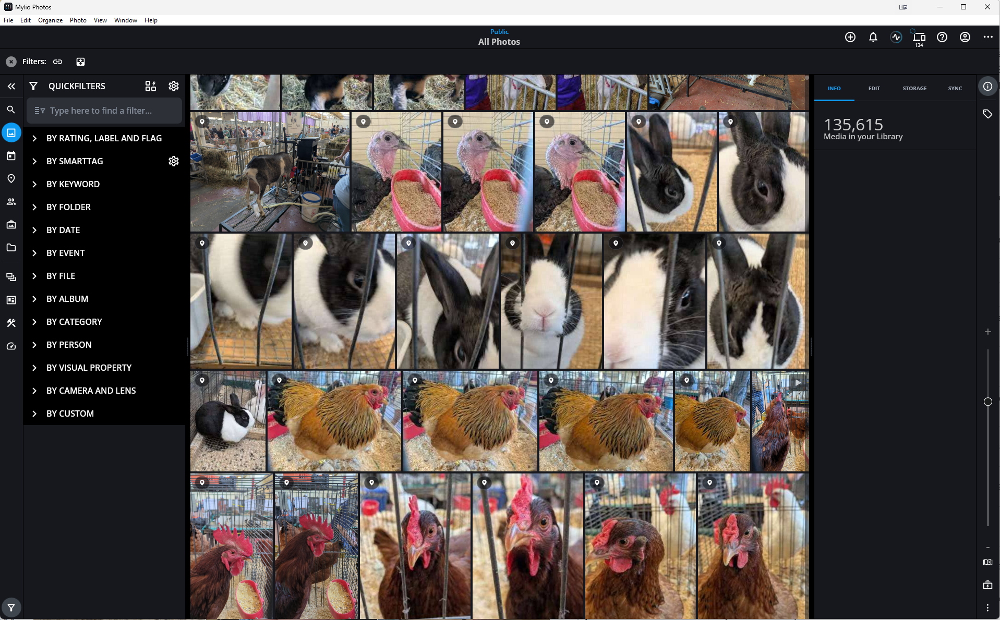
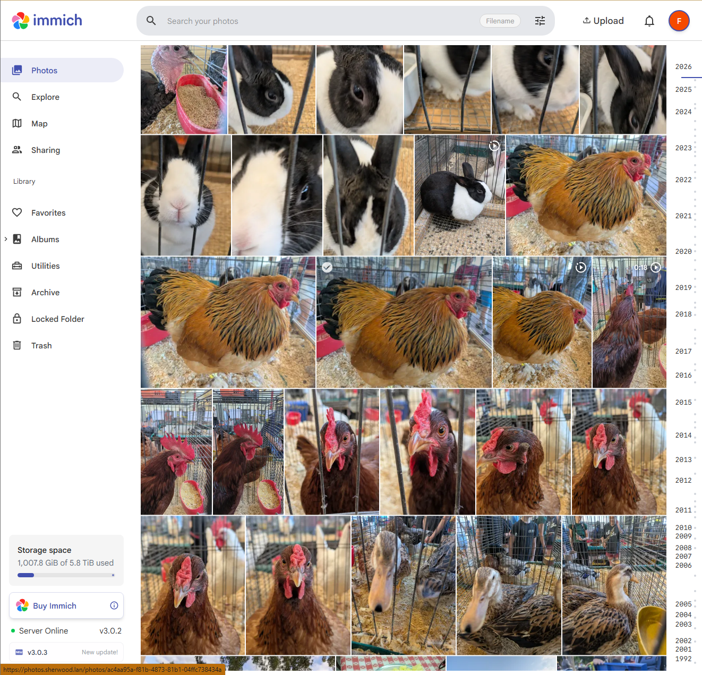

_**"We inspect the back-end data and compare it against the time and file of the crash during various time frames. I completely understand your willingness to look into this further. However, the type of investigation you're referring to requires access to data that isn’t available on your end. This information is only accessible through our backend systems, which means it can only be reviewed internally by our team."** -Mylio Support_

I recently reached out to Mylio support for help when the Mylio application on my PC began repeatedly crashing on startup. They helped me fix it quickly, but when I asked how I could do it myself if it happened again in the future, that was their reply.

**Those words hit me like poison**. "isn't available on your end" and "can only be reviewed internally by our team" produced an instant loss of trust in the company and the product. There's just no way I will ever feel ok about entrusting something as important as my family photos to a system that I don't have complete visibility into and requires the cooperation of a corporation.

Thus began my search for a Mylio alternative that gave me more control.

## Look, Mylio Isn't Bad

The key features that brought me to Mylio in the first place were:

1. A decentralized vault architecture, which managed storing and syncing multiple copies of photos across my devices without needing a commercial cloud account.
2. Mobile apps which would automatically sync photos from phones (which is where 99% of our photos come from these days) back to the permanent photo vaults.

Mylio is a decent product and may be the right solution for lots of folks. I think the team at Mylio has a strong vision and they've been responsive and helpful. The product does some neat things and has some ambitious ideas around photo management, and I've always felt that my photos were safe with Mylio, which is the most important feature of any photo library software.

Having said that, Mylio has never quite settled in as our permanent family solution for a number of reasons. The main Mylio challenges for me have been:

1. **It's not open enough**. Although there is a command line console which does let you poke at some of the underpinnings and the backing database, there's no API which limits what I can do to programmatically manage my Mylio library.
2. **Complex architecture**. I love the idea of decentralized vault syncing in theory. In practice, it's complex. It requires me keeping Mylio up to date and maintaining different configurations on a number of different devices. When syncing activity is occuring it's often unclear which systems are communicating and what they're trying to transfer and why. And while I've never felt my photos were at risk in Mylio, there have been numerous issues where I've needed to work with their support to get something unstuck or cleaned up. I've seen the system getting stuck generating thumbnails, getting stuck syncing vaults, locking up whenever any of the devices runs out of space, and the desktop app repeatedly crashing on startup, among other issues.
3. **Mobile app reliability**. The mobile apps have a background sync feature which is intended to sync photos even when the Mylio app isn't open. Unfortunately, I've found background sync to be touch-and-go. Sometimes it works, sometimes not. I tried to train family members to open Mylio periodically and let it sync, but was not very successful. To be fair, background sync is a struggle for lots of apps because of phone battery management policies.
4. **UX Issues**. I've learned my way around the app, but trying to show my family how to use it has illustrated that the UI is not always intuitive and the UX can be frustrating.

And then I got "black boxed" by support when I tried to learn how to fix something myself, which was the last straw for me.

## Retaking Control of our Photos

About two years back, we started getting warnings that our family's Google storage space was getting close to full. The vast majority of that space is consumed by photos and videos from our phones due to auto-backup to the Google cloud. I'd already bought more storage from Google once and wasn't keen to keep upping our subscription, so I looked around for a self-hosted solution. That's how I found Immich.

Immich is an open-source, self-hosted Google Photos clone. I used Google Takeout to export our photos and videos and then import them into Immich, allowing me to free up a bunch of space at Google. At the time, I was just trying to solve that very specific storage pressure problem, not create a new photo management paradigm, so Mylio has remained the source of truth. Since photos were also syncing from the phone to Mylio via the Mylio app, I didn't have to worry about syncing Immich -> Mylio, Immich was just going to be a local archive of Google Photos.

But then these recent Mylio experiences got me wondering if I could just centralize on Immich completely.

## A Mylio vs. Immich Comparison

Mylio is a traditional desktop app.

Immich on the other hand, as a Google Photos clone, is naturally a webapp.

Mylio is definitely more full-featured than Immich at the moment. They're not really trying to be the same thing, Mylio is more of a full-service photo management solution while Immich is more narrowly focused on image viewing and organization. This is apparent in the amount of editing features available in Mylio and how it enables offline work with photos.

Having said that, Immich has its advantages too, particularly in simplicity, privacy & control, and cost. Here's a more detailed comparison:

| Aspect | Mylio | Immich |
| ------ | ----- | ------ |
| Core Architecture | Decentralized Peer-to-Peer | Client-Server |
| Data Protection | Automatic syncing to multiple vaults. Vaults can be PCs, external/NAS drives, and cloud accounts. | No native duplication. Need to provide your own backup. |
| Data Sync | Foreground and background sync from mobile apps. Devices will also share photos at configurable levels of quality. | Foreground and background sync from mobile apps. |
| Storage Requirement | Each device has to have enough storage for the library at the configured quality level. | Storage is server-side, only the server needs to hold the entire library. |
| UX | Desktop and mobile apps. Traditional photo management application interface. | Website and mobile apps. Google Photos-like interface. |
| Photo Organization | Timeline, folders, albums, tags, keywords, ratings, faces, duplicate detection. | Timeline, albums, tags, faces, duplicate detection. |
| Photo Editing | Extensive. Integrates well with third-party editing applications. | Cropping and rotation. Poor integration with third-party editing applications. |
| Offline Access | Entire library available while offline on all devices at configurable level of quality. | None beyond what is locally cached/sourced from each device. |
| Cost | Free for one user, one device. $20/mo for 1 user w/ unlimited device syncing and mylio drive backup. More for more users. | Free when self-hosted. |
| Development | 2-3 significant releases per year. | 10+ significant releases per year. |
| Administration | Managing application updates, storage and configuration across several devices. | Managing a web server application and its storage, along with mobile apps. |
| Privacy & Control | Photos stay local, but phones home for authentication and device coordination. No API. | Everything is local. Full API as well as a CLI. |

When to choose Mylio

- Offline access is important.
- You need complex organization (e.g. folder hierarchies, both tags and keywords)
- You want rich photo editing options and strong integration with other photo editing software.
- You and your family are tolerant of a learning curve to use and maintain the application.
- You want multiple backup copies of the photos managed by the application.

When to choose Immich

- You want a paradigm that users are already familiar with (i.e. Google/iCloud Photos)
- You are comfortable running a Linux server (or paying for hosted Immich e.g. at DigitalOcean)
- You can provide your own backup strategy
- You want a no cost / low cost solution
- You want complete privacy and control
- You favor simplicity and reliability over functionality

## Migrating to Immich

I've chosen to migrate to Immich. Yes, I am losing some of the advanced functionality of Mylio, but the main thing I'm after is a safe repository of photos that my family will actually use. Immich can provide that more simply than Mylio. As an IT professional with an extensive homelab already set up, running Immich will not be an issue for me. The cost savings won't hurt, either.

Also, it's worth noting that Immich is [undergoing rapid development](https://immich.app/roadmap), so these downsides may be less of an issue moving forward.

### Installing Immich

I chose to install with Docker since I already have extensive docker infrastructure in place. They also provide instructions for Portainer, TrueNAS Scale, Unraid, Kubernetes, and Synology [in their documentation](https://docs.immich.app/overview/quick-start/).

### immich-go

A community command-line tool called [immich-go](https://github.com/simulot/immich-go) is a fantastic resource for migrating to Immich. It has specific workflows for migrating from Google Photos, iCloud, and local folders. The latter is what I used, pointing it directly at my Mylio vault on disk. It's a smart importer, checking for duplicates both within the import area and already on the Immich server, burst photo stacking, and RAW+JPEG image handling. It does its best to preserve as much metadata as possible, including from sidecar files. It's designed for importing large collections and has a good UI and log output for troubleshooting.

## Moving Forward

### Capturing New Images

I've installed the Immich app on our phones, so any pictures we take now automatically sync to the server. Note that as a self-hosted app, phones outside of your home network won't be able to reach the Immich server by default, you need to provide some mechanism for that. In my case, I use Tailscale to tunnel back into my home environment, after which I can use the internal URL of the server in my homelab (e.g. https://photos.yourdomain.com). And since I've set up Tailscale to be always connected on the phones, my family doesn't even need to think about sync, it just happens. You could instead open ports on your router to forward to the server, but that requires more security awareness to avoid making your home network vulnerable. Note that Immich also has the concept of internal vs. external URLs in its configuration, which may be useful depending on your setup.

For items that we don't capture via phones (the rare DSLR session, or random downloads) we can use the Upload function within the Immich interface.

### Backing Up Photos

My first line of defense is that the Immich library is configured on my NAS, which has redundant disks, protecting against a disk failure. Then, I backup that NAS folder nightly to my Backblaze B2 account using TrueNAS cloud backup functionality.

That takes care of the data. For the Immich database I have automated database dumps configured every night at 2am, and those are also backed up to my Backblaze account.

Finally, just for a belt-and-suspenders approach, a couple of times a year I dump the Immich library to an external HD which I keep offsite.

It's worth noting that the phones (Android in our case) are still configured to back up to Google Photos, as well. It'll likely be years before we run out of space there again, so that serves as another layer of backup for the vast majority of our photos.

## Conclusion

So far, the switch has been smooth and my family is much more likely to engage with our photo collection now. I'm not missing any particular Mylio features yet. The features I care most about, like duplicate detection and facial recognition, are as effective on Immich if not moreso. The server's performance on our 130K asset library is incredibly snappy despite being on a modest docker host alongside many other docker containers, and with storage on a NAS (albeit connected at 10Gbit).

Mylio definitely has its place (particularly for professional photographers IMO), but Immich is meeting our needs in a way that is much more aligned with my principles and philosophy. I'm happy, my family's happy. Let's call that a win!
